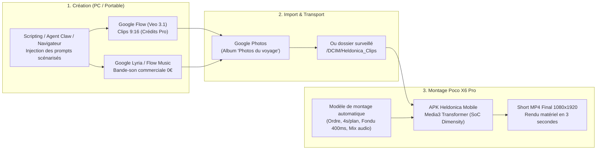

# 🎬 Guide Opérationnel — Flux de Création 0€ Additionnel (Flow + Lyria + Media3 sur Poco X6 Pro)

> **Statut :** Validé & Conforme aux licences commerciales  
> **Principe économique :** **0,00 € additionnel** (exploite l'abonnement Google Pro existant + matériel local Poco X6 Pro)  
> **Date de formalisation :** 15 octobre 2026  

---

## 1. La Règle d'Or Économique & Juridique

### A. Suno vs Google Lyria (Garde-fou Légal Majeur)
* ❌ **Suno (Offre Gratuite)** : **INTERDIT pour un usage commercial**.  
  Les conditions d'utilisation de Suno stipulent explicitement que les créations sur compte gratuit appartiennent à Suno et ne peuvent être diffusées que pour un usage strictement privé/non-commercial. Toute diffusion sur YouTube, Instagram ou pour la promotion d'Heldonica expose à un strike pour violation de droits d'auteur.
* ✅ **Google Lyria / Flow Music (Inclus dans Gemini Pro)** : **AUTORISÉ COMMERCIALEMENT**.  
  La génération musicale via Lyria (Google DeepMind) dans le cadre de votre abonnement mensuel Google AI / Gemini Pro accorde les droits d'exploitation pour vos contenus publics et monétisés, sans redevance ni coût additionnel.

### B. Coût d'Infrastructure : 0,00 €
* Pas de GPU cloud facturé à l'heure (RunPod, Replicate, AWS).
* Le smartphone **Xiaomi Poco X6 Pro** (SoC MediaTek Dimensity 8300-Ultra) prend en charge 100 % de l'assemblage et de l'encodage matériel H.264/AAC via **Media3 Transformer**.

---

## 2. Le Pipeline en 3 Étapes

---

## 3. Détail des Étapes

### Étape 1 : Création (Navigateur, Agent Claw ou Scripting)
1. **Automatisation / Injection de Prompts** :
   - Les prompts des scènes (ex. César au Rubicon, Chats de Péluse, Lisbonne 1147) sont générés par le Cerveau ou copiés en 1-clic via [`scripts/flow_prompt_helper.py`](file:///c:/Users/Work/heldonica-clean/scripts/flow_prompt_helper.py).
   - Un navigateur ou un agent de navigation (Playwright persistant via [`scripts/click_create_flow.py`](file:///c:/Users/Work/heldonica-clean/scripts/click_create_flow.py)) pilote l'interface de Google Flow.
2. **Génération Vidéo** :
   - 4 à 6 clips verticaux 9:16 générés avec les crédits mensuels Veo 3.1.
3. **Génération Musique (Lyria)** :
   - 1 piste de guerre ou d'ambiance de 30 à 60 secondes générée dans Flow Audio / Lyria (MusicFX).

---

### Étape 2 : Import vers le Smartphone Poco X6 Pro
1. **Dépôt des fichiers** :
   - Déposer les clips et la musique dans **Google Photos** (album synchronisé ou flux régulier).
   - Ou transfert direct par câble / Wi-Fi dans `/sdcard/DCIM/Heldonica_Clips`.
2. **Rapatriement d'origine** :
   - L'APK Heldonica Mobile s'appuie sur le Photo Picker système (`PickMultipleVisualMedia(6)`) déjà câblé dans `MainActivity.kt`.
   - Ce composant garantit l'accès au fichier binaire d'origine, **sans aucune recompression destructive** (résolution 1080x1920 et framerate 30/60 fps conservés).

---

### Étape 3 : Montage Automatique sur le Smartphone (Media3 Transformer)
1. **Sélection du Gabarit** :
   - L'application applique le modèle prédéfini [`ModelesMontagePredefinis.FLOW_CINEMA_SHORT`](file:///c:/Users/Work/heldonica-clean/heldonica-mobile/app/src/main/java/fr/heldonica/mobile/ModeleMontage.kt) :
     - **Découpe automatique** : 4 000 ms par plan.
     - **Transitions** : Fondu au noir soigné de 400 ms entre les plans ([`Fondu.kt`](file:///c:/Users/Work/heldonica-clean/heldonica-mobile/app/src/main/java/fr/heldonica/mobile/Fondu.kt)).
     - **Bande-son** : Musique Lyria mixée à 80 % du volume sonore (`volumeMusique = 0.80f`), son d'origine coupé.
2. **Encodage Matériel Éclair** :
   - Le moteur `Media3 Transformer` sollicite l'encodeur matériel **MediaCodec** du SoC Dimensity 8300 Ultra.
   - Durée d'assemblage : **3 à 5 secondes seulement** pour un Short complet de 24 secondes.
   - Sortie : Fichier MP4 prêt dans le stockage du téléphone pour publication directe sur YouTube Shorts ou Instagram Reels.

---

## 4. Bilan Synthétique

| Critère | Ancienne approche (PC Local) | Nouveau Flux (Flow + Lyria + Poco X6 Pro) |
|---|---|---|
| **Coût additionnel** | Électricité + usure PC local | **0,00 €** (forfait Google Pro existant) |
| **Licence Audio** | Suno Free = risque de ban commercial | **Google Lyria = conforme exploitation commerciale** |
| **Matériel de montage** | PC allumé avec FFmpeg lourd | **Xiaomi Poco X6 Pro (MediaCodec matériel)** |
| **Temps de rendu** | 2 à 5 minutes (CPU/GPU PC) | **~3 secondes sur smartphone** |
| **Dépendance réseau** | Nécessite LAN / Tailnet permanent | **Mobile autonome, transportable partout** |
