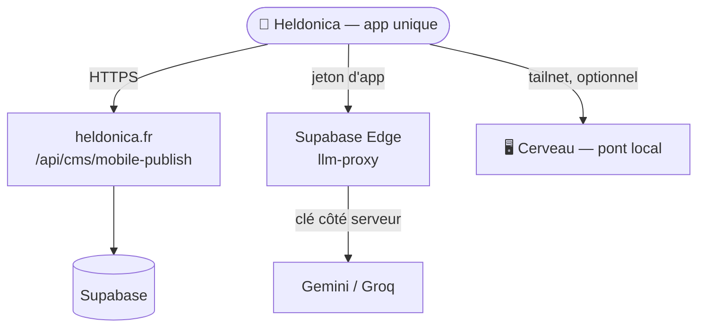

# Fusion des deux apps Android — étude et cible

> **Statut.** Étude du **2026-10-14**, en réponse à la question « peut-on fusionner
> les deux apps en une seule ? ». Ce document **fixe la direction** avant le code.
> Il est modifiable, mais on le modifie exprès — pas par accident.
>
> **Règle appliquée :** `AGENTS.md` — « On n'invente rien. » Chaque affirmation est
> adossée à un fichier du dépôt, avec un statut `[OBSERVÉ]`, `[INTERPRÉTATION]`,
> `[NON VÉRIFIÉ]` ou `[INDISPONIBLE]`.

---

## 1. Ce qu'on compare

Il existe aujourd'hui **deux projets Android distincts**, dans deux dépôts :

| | **Heldonica Mobile** | **Heldonica Studio** |
|---|---|---|
| Dépôt | `heldonica` (`heldonica-mobile/`) | `heldonica-brain` (`android/`) |
| Rôle | publier des photos sur le site + CMS | piloter le Cerveau (Studio) |
| Application ID | `fr.heldonica.mobile` | `fr.heldonica.studio` |
| Code Kotlin | **2 740 lignes** (7 fichiers) | **289 lignes** (3 fichiers) |
| Écrans | `MainActivity`, `EditeurActivity` | `MainActivity`, `CloudActivity` |
| AGP | **8.4.0** | **8.7.3** |
| Kotlin | **1.9.22** | **2.0.21** |
| compileSdk / minSdk / targetSdk | 34 / 26 / 34 | 35 / 24 / 35 |
| UI | Jetpack Compose | vues XML + WebView |
| Wrapper Gradle | complet (depuis PR #594) | **incomplet** (`gradlew` absent) |
| CI | `build-apk.yml` (dépôt heldonica) | `android.yml` (dépôt brain) |

`[OBSERVÉ]` : toutes ces lignes sont lues dans les fichiers de build et les manifestes
des deux projets.

---

## 2. La réponse courte

**Oui, c'est faisable — et c'est la bonne cible.** Mais ce n'est **pas** une fusion de
code, c'est une **consolidation d'app** : garder un seul projet (le plus gros), et
faire de l'autre un simple écran qu'on y ajoute.

La raison : les deux apps ne se chevauchent presque pas.

| Ce que fait l'une | Ce que fait l'autre |
|---|---|
| `[OBSERVÉ]` Picker photo → EXIF → OSM → `mobile-publish` | `[OBSERVÉ]` WebView du pont (mode PC) |
| `[OBSERVÉ]` Montage vidéo (Media3), sous-titres, fondu | `[OBSERVÉ]` `CloudActivity` → proxy LLM Supabase |
| `[OBSERVÉ]` Éditeur (WebView du panel CMS) | `[OBSERVÉ]` Config proxy + jeton d'app |
| `[OBSERVÉ]` Appelle déjà le Brain via `BRAIN_BASE_URL` | `[OBSERVÉ]` 3 fichiers, dont un client HTTP de 56 lignes |

`[INTERPRÉTATION]` : la fusion **ajoute** une capacité (le mode cloud) à l'app qui en a
déjà le plus. Elle ne réécrit rien.

---

## 3. Les obstacles réels (chacun avec sa solution)

### 3.1 Chaînes de build incompatibles

`[OBSERVÉ]` AGP 8.4 vs 8.7.3, Kotlin 1.9.22 vs 2.0.21, compileSdk 34 vs 35.

`[INTERPRÉTATION]` Il faut choisir **une** chaîne. La cible naturelle est celle du
mobile (AGP 8.4 / Kotlin 1.9.22 / compileSdk 34), parce que :

- `[OBSERVÉ]` `media3-transformer:1.4.1` est **épinglé** exprès : la note de
  `app/build.gradle.kts` dit qu'à partir de Media3 1.5 il faut compileSdk 36, que
  l'AGP 8.4 ne sait pas viser. Monter la chaîne casserait le montage vidéo.
- `[OBSERVÉ]` le code du Studio (289 lignes) n'utilise aucune API récente : il
  compile sur AGP 8.4 sans modification.

### 3.2 Deux UI différentes (Compose vs XML)

`[OBSERVÉ]` le mobile est en Jetpack Compose ; le Studio est en vues XML + WebView.

`[INTERPRÉTATION]` Coexistence sans réécriture : une activité Compose peut héberger une
`AndroidView` qui contient la WebView. On **porte** `CloudActivity` en un écran Compose
(un `TextField` + un bouton, c'est tout ce qu'il fait), pas l'inverse.

### 3.3 Le wrapper du brain est incomplet

`[OBSERVÉ]` `heldonica-brain/android/` n'a **pas** de `gradlew` — même problème que le
mobile avant la PR #594. Le build local y échoue aussi.

`[INTERPRÉTATION]` Ce n'est pas un obstacle de fond : c'est le même correctif à
appliquer. Mais tant qu'il n'est pas fait, la comparaison de builds locaux est biaisée.

### 3.4 Deux dépôts, deux CI

`[OBSERVÉ]` `heldonica-mobile/` vit dans le dépôt `heldonica` ; `android/` dans
`heldonica-brain`.

`[INTERPRÉTATION]` Une app unique doit vivre dans **un** dépôt. Cible proposée : le
dépôt `heldonica` (celui qui porte déjà l'app la plus lourde, ses outils `tools/`, son
keystore, son APK). Le `android/` du brain serait retiré au profit d'un renvoi.

### 3.5 Le point sensible : la clé Gemini dans l'APK

`[OBSERVÉ]` `heldonica-mobile/app/build.gradle.kts` déclare un `GEMINI_API_KEY`, et
`MainActivity.kt` (≈ ligne 1126) l'utilise pour un **appel direct à Gemini depuis le
téléphone**.

`[OBSERVÉ]` la règle du brain (`android/README.md`, `docs/ARCHITECTURE_ANCHOR_CLOUD.md`
§4) dit l'inverse : **« Aucune clé API dans l'APK. Un APK se décompresse ; une clé
embarquée s'extrait en minutes. »**

`[INTERPRÉTATION]` C'est la vraie tension de la fusion, et elle **précède** ta question
« Gemini ? ». Deux apps qui appliquent deux règles de sécurité opposées ne peuvent pas
fusionner telles quelles. La cible cohérente : **le mobile perd sa clé Gemini et passe
par le proxy** (`supabase/functions/llm-proxy`, déjà écrit côté brain), avec un jeton
d'app révocable.

---

## 4. Schéma cible

Une seule app, trois usages : **publier** (photo/CMS), **créer** (proxy LLM),
**piloter** (pont local quand le PC est allumé).

---

## 5. Étapes proposées

| # | Étape | Livrable | Statut |
|---|---|---|---|
| 1 | Cette étude | `docs/FUSION_APPS_ANDROID.md` | fait (ce document) |
| 2 | Décider la **cible** : dépôt, chaîne de build, id d'app | décision écrite | **à valider par l'utilisateur** |
| 3 | Porter `CloudActivity` + `CloudClient` en Compose dans le mobile | `heldonica-mobile/` | à faire |
| 4 | Retirer `GEMINI_API_KEY` de l'APK, passer par le proxy | `build.gradle.kts`, `MainActivity.kt` | à faire |
| 5 | Retirer `android/` du brain, poser un renvoi | `heldonica-brain/` | à faire |
| 6 | Un seul workflow CI pour l'app unique | `.github/workflows/` | à faire |
| 7 | Construire et installer l'APK unique | `app-debug.apk` | à faire |

---

## 6. Décisions ouvertes

1. **Nom et icône de l'app unique** — « Heldonica Mobile » ? « Heldonica » ?
   `[INDISPONIBLE]` aucune décision de ce type n'existe dans le dépôt.
2. **Fournisseur LLM par défaut** — Gemini vs Groq. Voir §7.
3. **Le mode « Studio (PC) » survit-il ?** `[INTERPRÉTATION]` oui, il devient un
   troisième usage de la même app, pas une app séparée.

---

## 7. Gemini : ce que ça change (réponse à « Gemini ? »)

`[OBSERVÉ]` le fournisseur par défaut du proxy est **Groq** ; Gemini est un fournisseur
alternatif (`supabase/functions/llm-proxy/`, README du brain).

`[OBSERVÉ]` `docs/ARCHITECTURE_ANCHOR_CLOUD.md` §8 marque comme **à trancher par
l'utilisateur** : « Gemini (gratuit, mais débit limité et le tier gratuit peut réutiliser
les données) vs Groq / OpenRouter ».

`[INTERPRÉTATION]` Choisir Gemini est cohérent **à une condition** : que la clé reste
côté serveur (dans le proxy), jamais dans l'APK. C'est la seule façon de concilier ton
choix Gemini avec la règle de sécurité du projet. Si la clé Gemini devait rester dans
l'APK, alors la fusion des deux apps rouvrirait exactement la faille que le brain a
corrigée.

---

## 8. Historique

| Date | Événement |
|---|---|
| 2026-10-14 | Création. Étude de fusion : cible = une app unique dans le dépôt `heldonica`, clé LLM sortie de l'APK. |
